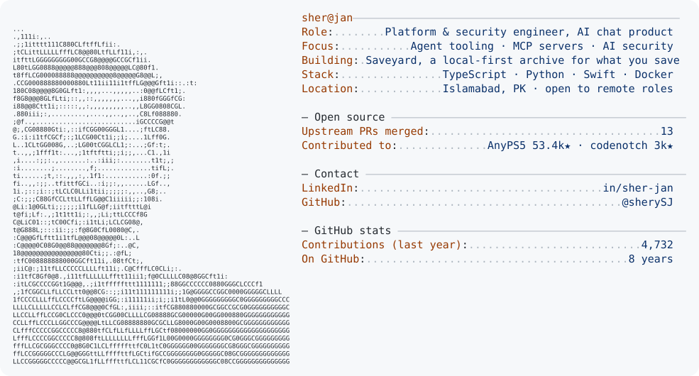

<a href="https://www.linkedin.com/in/sher-jan/">
  <picture>
    <source media="(prefers-color-scheme: dark)" srcset="https://raw.githubusercontent.com/sherySJ/sherySJ/main/dark_mode.svg">
    
  </picture>
</a>

### Open-source highlights

| Project | What I fixed |
|---|---|
| [vinzdg/codenotch](https://github.com/vinzdg/codenotch) (Swift) | Made the cost indexer's per-pass file check 34× faster (432.8 → 12.8 ms over 6,105 transcripts), which had kept a quarter of a CPU core busy ([#501](https://github.com/vinzdg/codenotch/pull/501)); usage parsing fixes for Claude, Kiro and MiniMax ([#527](https://github.com/vinzdg/codenotch/pull/527), [#528](https://github.com/vinzdg/codenotch/pull/528), [#529](https://github.com/vinzdg/codenotch/pull/529)) |
| [boykopovar/AnyPS5](https://github.com/boykopovar/AnyPS5) (C++) | libc, kernel and network-stack correctness: errno in `localtime` ([#4015](https://github.com/boykopovar/AnyPS5/pull/4015)), RFC 5780 STUN parsing ([#16303](https://github.com/boykopovar/AnyPS5/pull/16303)), shared CRT and locale state across modules ([#16933](https://github.com/boykopovar/AnyPS5/pull/16933)) |

**Building:** Saveyard, a local-first archive of everything you save on X, GitHub and Reddit, classified by AI against your own goals and searchable by your agents over MCP. Open-sourcing soon.

**How I work:** small, well-scoped changes with the evidence attached: tests, before-and-after measurements, and a clear note on how each change was verified. I use AI coding tools with the same discipline as any other tool: I own the design, the tests and the review, and I answer maintainer feedback the same day.

**Open to** remote contract and full-time roles in agent tooling, developer infrastructure and AI security. [LinkedIn](https://www.linkedin.com/in/sher-jan/)
